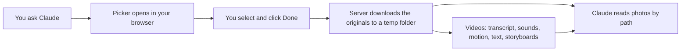

# Google Photos MCP

**Hand Claude the photos and videos on your phone.** Pick them in Google Photos, and Claude gets the original files in seconds. It can read slides, redraw whiteboards, and watch your videos, with speech, sound, and motion included. Everything after the download runs on your Mac.

```
You:    Watch the video I just took and tell me what happens.
Claude: A Google Photos picker is open in your browser. Select the video, then click Done.
        ...
        It's a 26-second selfie. You introduce yourself and say this is a test of the video MCP,
        then turn the camera to a framed print of zebras crossing a savanna...
```

## Without it, and with it

**Without it:** you open photos.google.com, download each file, find it in Downloads, and paste paths into the chat. A video stays a sealed box, because Claude cannot play it.

**With it:** you ask. A picker opens in your laptop browser, already signed in. You select and click Done. Claude has the originals, their capture times and camera details, and for videos a full timeline of what was said, heard, and shown.

## What you can ask

- "Take notes from the slide photos I took in this morning's talk."
- "Turn the whiteboard photo I just took into a Mermaid diagram."
- "Grab the 150 photos of the chair I shot for photogrammetry and check none are missing."
- "Watch the video from my walk and tell me what the dog was barking at."
- "In the clip I took at the concert, when does the crowd start cheering?"
- "Watch this local file, ~/Movies/demo.mov, and write a summary."

## Key features

- **One device.** The picker opens on your laptop. No QR codes and no phone steps.
- **Original files.** Full-resolution photos and videos, with EXIF capture time, camera, lens, and exposure.
- **Videos Claude can understand.** `watch_video` returns a timestamped transcript, sound events, camera and subject motion, on-screen text, people, storyboards, and a spectrogram in one call. `inspect_video` zooms in on any moment.
- **Fast.** A 13-second 4K clip is ready in about 2.3 s on an M4 Pro, and a picked video is processed in the background before Claude even asks.
- **Sized for the conversation.** Every video result stays under Claude Code's 10,000-token MCP warning, so nothing is cut off.
- **Local and free.** Speech, sound, motion, and text analysis run on your Mac with open models and Apple frameworks. There is no paid API and no extra account.
- **Leaves nothing behind.** Downloads go to a temp folder and are deleted when the session ends, or after 24 hours.

## How it works



Since March 2025, Google lets apps see only the photos you select in its picker. This server follows that model: you choose, and Claude works with exactly what you chose.

## What Claude sees in a video

`watch_video` turns a video into one timeline, plus a few images. This excerpt comes from an 11-second test clip with a spoken line, a red box sliding across a still frame, and a short bang:

```
## 0:00.0-0:05.0 (shot 1)
Motion:
  0:00.0-0:04.8 Camera still. Nothing else moves.
Speech:
  [0:00.5] Welcome to the demo. The red box moves to the right.

## 0:05.0-0:11.0 (shot 2)
Motion:
  0:06.5-0:10.8 Camera still. Something moving right (slow) from the left side to the center, covering a small area.
Frames: f02 0:05.5, f03 0:06.0, f04 0:06.6, ...
Sounds:
  0:08.0 sudden sound, unlabeled (-14 LUFS, out of silence)
```

Inline images come with it: up to four storyboards of nine frames each and a spectrogram of the audio. Full-resolution keyframes stay on disk for Claude to open when it needs detail.

| Signal | Source |
|---|---|
| Speech | whisper.cpp (`large-v3-turbo`) with voice activity detection |
| Sounds | Apple's on-device sound classifier, plus loudness jumps and silences |
| Sounds you name | `listen_for: ["a door slamming"]`, scored with the open CLAP model |
| Motion | Vision optical flow at 4 frames per second, with a camera fit that separates pans, tilts, zooms, and handheld drift from things moving in the frame |
| Text and people | Vision text recognition, human detection, face detection, and body pose |
| Pictures | Storyboards, keyframes, and a spectrogram |

## Quick start

You need a Mac, Node.js, Homebrew, and a Google account whose photos back up to Google Photos.

1. **Create a Google OAuth client.** In the Google Cloud console:
   - Create a project and enable the **Photos Picker API**.
   - In **Google Auth Platform**, set the audience to **External** and add yourself as a test user.
   - Create an OAuth client of type **Desktop app**. Save its JSON as `~/.config/gphotos-mcp/client_secret.json`.

2. **Install the media tools** for videos:

   ```sh
   brew install ffmpeg whisper-cpp imagemagick uv
   xcode-select --install   # the build compiles a small Swift helper
   ```

3. **Build:**

   ```sh
   npm install
   npm run build
   ```

4. **Register with Claude Code:**

   ```sh
   claude mcp add --scope user gphotos -e GPHOTOS_SOURCE=picker -- node "$PWD/dist/index.js"
   ```

5. **Ask for a photo** in a new Claude Code session. The first time, a Google sign-in tab opens. The refresh token goes into your macOS Keychain.

The first video call downloads the whisper models (about 1.6 GB), and the first `listen_for` call downloads CLAP (about 1.4 GB). Both go to `~/.cache/gphotos-mcp/models/` and are reused after that.

## Tools

| Tool | What it does |
|---|---|
| `pick_photos` | Opens the picker, waits for Done, downloads the originals, and returns a manifest with paths, capture times, and camera data |
| `list_picked` | Filters what you already picked by time, camera, or type, without opening the picker again |
| `watch_video` | Turns a picked or local video into a timeline of speech, sounds, motion, on-screen text, and people, with storyboards and a spectrogram |
| `inspect_video` | Looks closely at one window of a video: dense frames, frame-by-frame motion, a motion trail, a spectrogram, and optional `listen_for` checks |
| `cleanup_photos` | Deletes the downloaded files now |

The server also ships prompts that chain these tools for common jobs. In Claude Code they appear as slash commands:

| Prompt | For |
|---|---|
| `/mcp__gphotos__watch_video` | Watching a video and explaining what happens |
| `/mcp__gphotos__notes_from_slides` | Notes from photos of presentation slides |
| `/mcp__gphotos__diagram_to_mermaid_or_markdown` | Whiteboards, diagrams, and handwritten pages |
| `/mcp__gphotos__ingest_photo_set` | Large sets, such as a photogrammetry capture |

## Privacy and security

- **Scope:** the only Google permission is `photospicker.mediaitems.readonly`. Google shares only the items you select, and the server cannot browse or change your library.
- **Credentials:** the OAuth client file stays in `~/.config/gphotos-mcp/`, and the refresh token stays in your macOS Keychain.
- **Your files:** downloads and video analysis live under your temp folder. They are deleted when the server stops, or after 24 hours.
- **Local analysis:** video and audio never leave your Mac. The only network calls go to Google's Photos Picker API and, once, to download the open models and their Python packages.

## Limits

- **You do the picking.** Google does not let apps search your library. You can type a place, person, or subject into the picker's search box.
- **No location.** Google removes GPS from picker downloads.
- **macOS only.** The server uses `open`, the Keychain, `sips`, Apple's Vision and SoundAnalysis frameworks, and VideoToolbox for HEVC video.
- **Claude reads the audio.** It gets a transcript, sound labels, and a spectrogram. It does not hear tone of voice or music the way you do, and there are no speaker labels yet.
- **Motion is sampled.** Very fast moments between samples can be missed unless Claude zooms in with `inspect_video`. Speeds are relative, and a fast phone swing can count as a new shot.
- **Weekly sign-in.** While the OAuth app stays in Testing mode, Google asks you to sign in again every 7 days.

## Development

```sh
npm test
npm run lint
```

The video integration test builds a 30-second clip with known speech, cuts, motion, and sounds, then checks that the pipeline finds each one. It skips itself until the models are downloaded.

The `spe/` folder holds the design work and its evidence:

- `spe/evals/video-eval.md` measures answer quality and response size against reference facts.
- `spe/evals/video-speed.md` measures each speedup and checks it did not change the output.
- `node spe/evals/video-smoke.mjs <video> <start> <end>` runs both video tools through the built server.
- `node spe/evals/video-trial.mjs <round> <video> <n>` runs one paid headless Claude Code trial and grades it.
- `GPHOTOS_CONFIG=a` through `e` select the five tool designs compared in round 1. Config `c` is the default.
